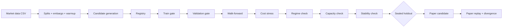
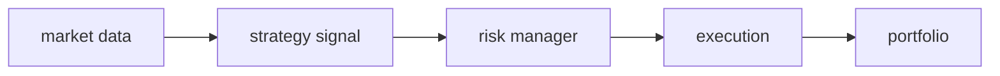

# Falcon Research Engine

**An open-source autonomous quantitative research engine.**

**Generate strategies. Break them. Promote only the survivors.**

Falcon generates quantitative strategy candidates and evaluates them
through chronological validation, walk-forward testing, transaction-cost
stress, regime analysis, liquidity/capacity checks, parameter stability,
and paper promotion. Only robust survivors are promoted — everything else
is rejected with a persisted, machine-readable reason.

Falcon does **NOT** guarantee profitable strategies. Backtests do not
predict future returns. Live-money paths are disabled by architecture.

## Quick start (~2 minutes, fully offline, no keys, no funds)

```bash
git clone <your-fork-url> falcon-research-engine
cd falcon-research-engine
pip install .
falcon research --data data/sample_ohlcv.csv --limit 4 --seed 7 --db falcon.db --campaign-id demo
falcon report --db falcon.db --campaign-id demo
```

Expected output (real run on the bundled sample data):

```text
Falcon campaign demo (BTC/USDT, ds_19ad3eaab1f5)
generated=4 dup_skipped=0 optimizer=random trials=0
funnel: train_evaluated:0ok/4rej -> validated:0ok/0rej -> cross_market:0ok/0rej -> walk_forward_passed:0ok/0rej -> cost_stress_passed:0ok/0rej -> regime_passed:0ok/0rej -> capacity_passed:0ok/0rej -> paper_candidate:0ok/0rej
promoted=0 []
rejections: insufficient_trades=2, unrealistic_performance=2
holdout_accesses=0 (sealed)
```

Zero survivors is a valid research result: the funnel rejected honestly
instead of overfitting. Tougher data and larger searches behave the same
way — only robust candidates promote.

Then try the versioned 1h datasets, or run the test suite
(`python -m unittest discover -s tests` — see Development below).

## Architecture



Per-trade flow (unchanged, strategies never execute orders):



### Modules

| Module | Role |
|---|---|
| `research/` | Candidates, families, generation, gates, scoring, regimes, stability, campaigns, paper promotion, SQLite store, reports |
| `strategy/` | V1 baseline strategies (historical, rejectable — never retouched) |
| `backtest/` | Next-bar replay, warmup context, liquidity-aware fills, cost attribution |
| `evaluation/` | Temporal splits, walk-forward, cost sweeps, capacity, metrics, CSV/JSON export |
| `market_data/` | CSV OHLCV import + multi-file datasets, dedup, reconnect guards |
| `exchange/` | Paper adapter (fees, spread, slippage, impact, participation); live adapter gated + unimplemented |
| `execution/` | Risk-gated order execution, idempotent retries |
| `risk/` | Final authority: sizing, SL/TP, loss limits, cooldown, kill switch |
| `portfolio/` | Cash/positions/PnL accounting with fees |
| `paper/` | Real-time simulation engine (reused by paper promotion) |
| `config/` | Env/file configuration, live-trading safety interlock |
| `bot_logging/`, `metrics/` | Structured logging, in-memory metrics |

## Quick start (full offline demo, no keys, no funds)

```bash
pip install .                               # provides the `falcon` CLI
falcon research \
  --data "data/sample_ohlcv*.csv" \
  --families momentum mean_reversion breakout \
  --limit 16 --seed 7 --db falcon.db --campaign-id demo16
falcon report --db falcon.db --campaign-id demo16
# Without install, the same CLI runs as: python scripts/falcon.py ...
# Add --verbose (INFO) or --log-level DEBUG for detailed simulation logs.
```

Real historical data (public Binance klines, no key required):

```bash
python scripts/fetch_data.py --symbols BTCUSDT ETHUSDT --interval 1h \
  --start 2021-01-01 --end 2025-01-01 --out data/raw
# build validated + versioned datasets (hash-verified on every load):
python -c "from research.datafiles import build_versioned_dataset;
build_versioned_dataset('data/raw/BINANCE_BTCUSDT_1h.json', 'data/falcon-BTCUSDT-1h.csv', 'data/falcon-BTCUSDT-1h.manifest.json')"
falcon dataset inspect data/falcon-BTCUSDT-1h.manifest.json
falcon research --data "data/falcon-*1h.manifest.json" \
  --symbols BTC/USDT ETH/USDT --limit 100 --seed 7 \
  --db falcon_real.db --campaign-id real100
```

> Glob patterns above stay quoted so Python (not the shell) expands them
> deterministically via `market_data.load_ohlcv_dataset` on all platforms.

## Live market data

Falcon supports live **public market data** (read-only — no trading anywhere):

```bash
falcon live --provider binance --symbol BTCUSDT --interval 1m --duration 20
falcon live --provider solana --mint <MINT_ADDRESS> --duration 20
```

- **Binance requires no API key.** REST bootstrap (recent klines, 24h
  ticker, best bid/ask) plus public WebSocket streams (kline, bookTicker,
  miniTicker). Forming vs closed klines are distinguished explicitly
  (`Candle.is_closed`); forming bars never enter finalized history.
- **Solana uses mint-address identity.** Copy a token mint from anywhere
  (e.g. a token you discovered on Axiom) and Falcon independently resolves
  the on-chain market via documented public infrastructure (DexScreener
  public token API by default, no key; optional `FALCON_SOLANA_RPC_URL`
  for decimals enrichment). Axiom compatibility is independence: no Axiom
  account, no scraping, no private Axiom endpoints, no wallet, no signing,
  no swaps.
- Unknown metrics report as `unavailable` (never `0` unless measured).
- Pool selection is deterministic: strongest-liquidity Solana pool wins,
  ties break by volume then address; the selected DEX/pool/quote is shown.
- Best-book only: neither provider claims a full L2 order book (Binance
  exposes best bid/ask snapshots; Solana exposes pool liquidity).

Data-source limitations: aggregation, pool selection and latency differ
from any single venue display, so Falcon reports its own source honestly —
exact tick equality with other UIs is not expected.

## Falcon Terminal (experimental)

**EXPERIMENTAL · READ-ONLY · NO LIVE EXECUTION.** A native desktop
watchlist over Falcon's live public market data. It observes only: no
signals are generated, no orders exist, no wallet is ever touched.

```bash
pip install -e ".[terminal]"   # GUI stack is optional (stdlib Tkinter)
falcon terminal --provider binance --symbol BTCUSDT
falcon terminal --provider solana --mint <MINT>
# without install: python -m falcon_terminal --symbol ETHUSDT --mint <MINT>
```

Requires Python 3.10+ with Tkinter/Tcl-Tk and a desktop display. Windows
Python installers include an optional Tcl/Tk component; Linux distributions
typically provide `python3-tk`. No additional Python runtime packages.
The default watchlist opens Binance BTCUSDT and wrapped SOL on Solana
(`So11111111111111111111111111111111111111112`). Override with
`--symbol ETHUSDT --mint <MINT> --poll-interval 15`, or change both targets
live in the Market Selection panel (previous feeds stop cleanly first).

The native Radar/Market table and selected-asset panel update automatically
at ~10 Hz while the backend ingests at full feed rate (latest state wins;
bounded queues, no widget recreation). Binance shows price, 24h change,
best bid/ask, spread, the current candle (OHLCV with FORMING/CLOSED state)
and a live price sparkline drawn only from observed prices. Solana shows
available USD price, pool, liquidity, five-minute volume and buys/sells.
Missing fields render as `—`. Provider state, stale status, received-message
count and last receipt time stay visible. Receipt age measures feed activity,
not the age of each individual quote; identical DexScreener responses can
keep the feed alive. Signal/Status is deliberately inactive; no execution
engine is loaded and no buy/sell/order control exists anywhere in the UI.

`falcon_terminal.app` only consumes immutable DTOs through an event bridge.
`falcon_terminal.bridge` owns providers on a background asyncio thread and
coalesces snapshots into a bounded latest-value queue. Network bootstrap
runs after the window opens; providers connect independently. Closing the
window cancels startup/readers, disconnects providers and waits for pending
HTTP work while keeping the window responsive. No local server is exposed.

Run offline regression tests with `python -m unittest tests.test_terminal -v`.
For an **explicit live GUI smoke test** (opens a real window and auto-closes):

```bash
python scripts/smoke_terminal.py --duration 50 --out reports/terminal-smoke.json
```

The smoke checks rendered widgets, both feed counters across subsequent
updates, changing Binance quotes, asset selection, and worker termination.
It exits nonzero if evidence is insufficient or a feed cannot connect.
Public endpoints must be reachable. This remains a two-asset watchlist,
not automatic token discovery or ranking; Solana uses aggregated polling
(15 seconds by default), not a trade stream. No signal calculation,
paper portfolio, persistence or packaged desktop installer in this prototype.
Release tag `v0.1.0` and release notes remain unchanged.

## Research pipeline

1. **Generate** — deterministic random/grid/perturbation search over explicit
   parameter spaces (`research/strategies.py`, `research/generate.py`);
   optional GP+EI Bayesian optimizer (`research/optimizer.py`, seeded).
2. **Train / Validate** — temporal split with embargo; gates reject negative
   expectancy, poor profit factor, excess drawdown, too few trades,
   train/validation divergence, unrealistic Sharpe/win-rate.
3. **Cross-market** — same candidate must pass on every symbol (BTC/ETH);
   median expectancy/PF and worst-market drawdown are gated.
4. **Walk-forward** — folds with indicator warmup (never scored, never future
   data); rejects unstable fold performance.
5. **Cost stress** — full configured multiplier matrix (default
   1x/1.5x/2x/3x/5x); the maximum-multiplier scenario must keep minimum
   profit factor (never a hardcoded scenario name).
6. **Regime check** — trailing-only regime labels (trend up/down, sideways,
   high/low vol), per-regime net/PF/expectancy/drawdown; rejects
   single-regime concentration.
7. **Capacity check** — scaled-capital replay with participation caps and
   market impact; rejects unscalable candidates.
8. **Stability check** — parameter neighbours (median/worst/dispersion
   reported); sharp isolated optima penalized.
9. **Multiple-testing report** — trials count, 95% LCB on expectancy,
   snooping warning; "insufficient evidence" when n < 10 closes.
10. **Sealed holdout** (optional, explicit) — most-recent tail opened in
    `final` mode only, once per promoted candidate, every access logged
    and persisted at access time (policy A: repeated final-mode opens are
    permitted, each one logged — never one-time semantics). Never used for
    selection or ranking. `holdout_accesses=0` proves no holdout bars
    flowed through research or confirmations in-process; it does not prove
    the CSV was never read out-of-band.
11. **Paper candidate** — replayed through the identical stack; rolling
    divergence vs backtest reported with warnings.

Current verified capabilities: 239 automated tests (full suite green),
6 strategy families, 2 execution models (`next_open`/`next_close`),
versioned datasets with sha256 verification (see Data below), every
rejection persisted with reason + metrics in SQLite, clean installed
`falcon` CLI. Historical large-campaign evidence lives in
`RELEASE_NOTES_v0.1.0.md` (Research history) — not repeated here.

## Promotion gates & scoring

Thresholds live in `research/gates.py::GateConfig` (inspectable). Ranking
uses a transparent multi-metric score (`research/scoring.py`:
`SCORE_WEIGHTS` sum to 1, every component reported) — never net PnL alone.
Complexity is penalized; cost sensitivity, regime concentration, turnover
without edge, and sparse samples are penalized.

## Reports

- `falcon report --db ... --campaign-id ...` → terminal funnel + survivors +
  rejection reasons; `--out` writes JSON + per-candidate CSV.
- `scripts/evaluate.py` → regime/walk-forward/cost/capacity JSON + CSV.
- Rejected candidates are preserved in SQLite forever
  (`candidates` + `evaluations` tables).

## Data & provenance

- `data/sample_ohlcv.csv` — tiny bundled demo sample (used by Quick start).
- `data/falcon-<SYM>-1h.csv` + `.manifest.json` — canonical 1h datasets for
  BTC/ETH (from 2017-08-17), BNB (from 2017-11-06), SOL (from 2020-08-11),
  all to 2025-01-01; 8 versioned datasets (1h + 4h resampled per symbol).
- `scripts/fetch_data.py` reproducibly downloads public Binance klines
  (no key required) into `data/raw/` (git-ignored, never committed).
- `scripts/build_dataset.py` deterministically validates and versions raw
  dumps into canonical CSV + sha256 manifest (verified on every load).

Provenance/licensing note: Apache-2.0 covers Falcon's code, not
third-party market data. Bundled CSVs derive from public Binance klines;
check Binance's terms before any use beyond local research. Gaps are
recorded in manifests, never filled.

## Development

```bash
python -m unittest discover -s tests   # full suite (239 tests)
python scripts/falcon.py --help        # CLI without install
```

See `CONTRIBUTING.md` for workflow, style and pull-request expectations.

## Limitations (honest)

- Public 1h klines have small gaps (recorded, never filled); conclusions do
  not transfer to live markets.
- Execution model is a participation/impact approximation, not a
  limit-order-book replay; resting limit fills assume maker availability.
- Regime labels are simple trailing statistics, not a market model.
- The Bayesian optimizer is wired into campaigns behind `--optimizer bayes`
  (OFF by default; random search remains the default). All optimizer trials
  run on TRAIN only and are persisted with the `optimizer_trial` stage.
- CI config is provided but remote GitHub CI has not executed it yet —
  **CI configuration validated locally; remote GitHub CI not yet executed**.

## Roadmap toward v1.0 (~10% remaining)

- [x] Real long-horizon versioned datasets: 1h canonical + 4h resampled
  for BTC/ETH (from 2017-08-17), BNB (from 2017-11-06), SOL (from
  2020-08-11), all to 2025-01-01, all hash-manifested (8 datasets, see
  Data & provenance).
- [x] Bayesian optimization wired into campaigns behind `--optimizer bayes`
  (OFF by default; random search remains the default).
- [ ] Limit-order-book replay (Level 2) for execution realism.
- [ ] Regime-conditional strategies and asymmetric long/short costs.
- [ ] Rolling paper-divergence alerting over live paper sessions.
- [ ] Docs site + first tagged release after green remote CI.

## Risk disclaimer

This software is for **research and education**. Backtests — however
careful — do not predict future returns. Never trade real money with it:
live-money paths are disabled by architecture, and any future live adapter
will remain explicitly gated. You are solely responsible for any use.

## License

Apache-2.0 (see `LICENSE`). Contributions under `CONTRIBUTING.md`;
security policy in `SECURITY.md`.
